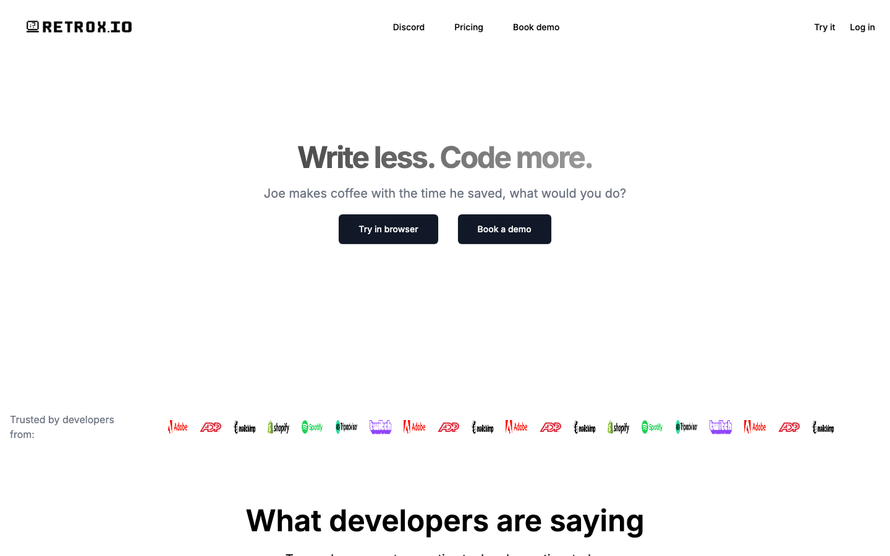
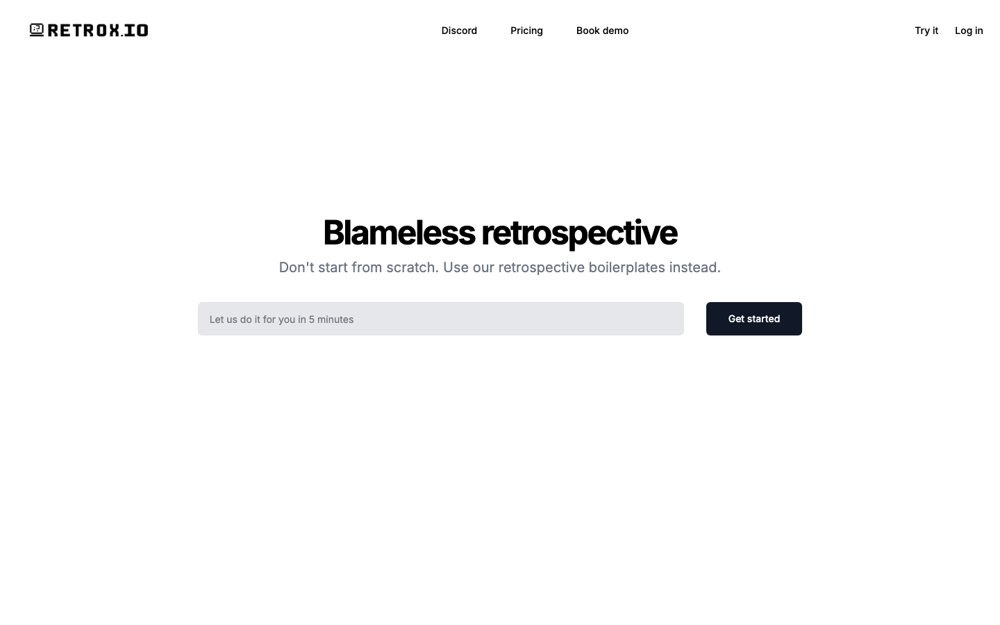
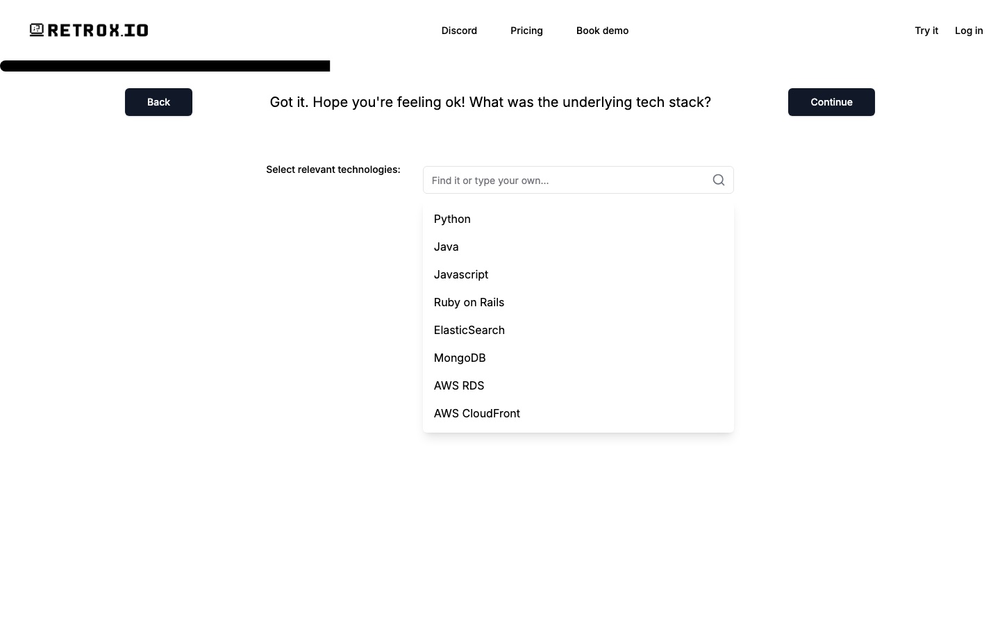
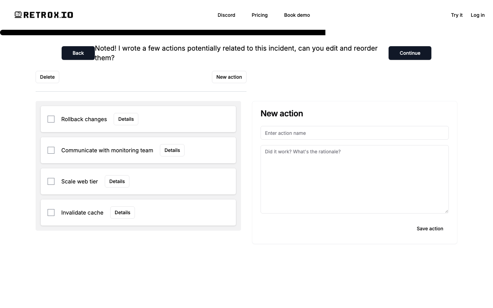
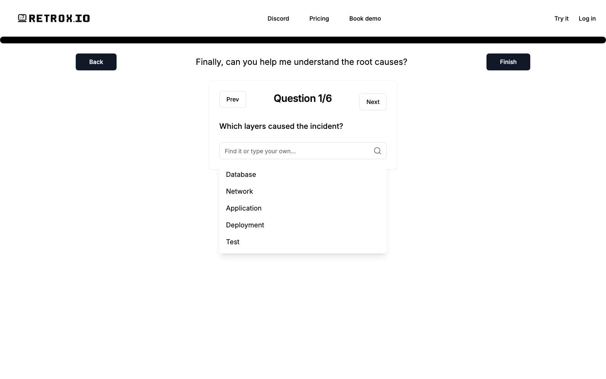

# Retrox.io

**Blameless incident retrospectives, written in minutes instead of hours.**

After an incident, engineers rarely have the time or energy to write a thorough postmortem. Retrox is a guided "retrospective ghost writer": instead of starting from a blank doc, you answer a short series of prompts and it assembles a structured, blameless postmortem for you.

### How it works

1. **Name the incident:** give it a title.
2. **Describe the stack:** pick the technologies involved (Python, MongoDB, AWS RDS, …) or type your own.
3. **Review the actions taken:** Retrox suggests likely response actions (rollback, scale web tier, invalidate cache…). You edit them, add details on whether each one worked, and drag them into order.
4. **Find the root causes:** a short guided questionnaire (which layer failed, and why) to get past the symptoms.

> **Status:** UI-only MVP. The wizard is clickable end to end, but suggestions are placeholder data and nothing is generated by a backend yet.

### Repo layout

| Folder | What it is |
|---|---|
| `nextjs-mvp/` | The retrospective writer app (Next.js 14, Tailwind, shadcn/ui, Supabase auth) |
| `landingpage/` | Landing page for SLO project sign-ups |

## Demo

The retrospective writer walks you through a postmortem step by step at `/new/0` → `/new/3`.

**Home** (`/`)



**Step 0 – Title** (`/new/0`)



**Step 1 – Tech stack** (`/new/1`)



**Step 2 – Actions taken** (`/new/2`): edit and drag to reorder the actions taken during the incident



**Step 3 – Root causes** (`/new/3`): guided questions about the root cause



## Contribute

Navigate to the project folder, then run the following steps(make sure you have docker running locally):
```
make build // to build the image and listen to changes locally

make up // to only run the container without building

make firebase // to deploy a change to production(you need firebase login)
```

You should have the application running at port 3000. 

To contribute, always test things locally first and make sure `make up` work for you.

First, create your own branch:
```
git checkout -b <your-new-branch>
```

Then, create a PR for merge requests. Add @chuns-wuu for review.


## Troubleshooting
### Firebase
  1. The project runs on Node 26 (pinned via `engines` in `package.json` and `.nvmrc`). Run `nvm use` in `nextjs-mvp/` or `landingpage/` before `make firebase`. If firebase-tools fails, update it with `npm i -g firebase-tools@latest`.
  2. "Got source token undefined for region us-xxx" or "CloudRunServiceNotFound" during firebase deployment can be resolved by manually granting the permission in the [Google console](https://console.cloud.google.com/functions/list?authuser=2&hl=en&project=retroxsignup) and redeploy on the UI as well.

